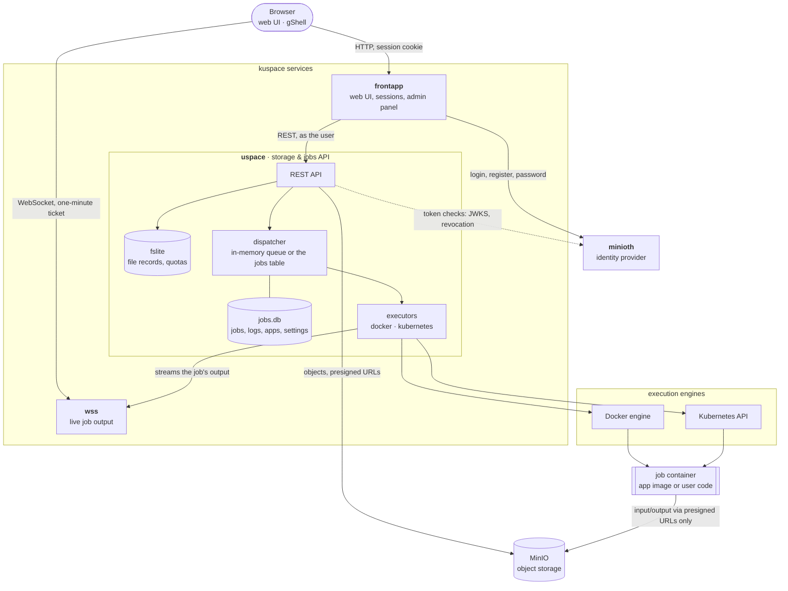
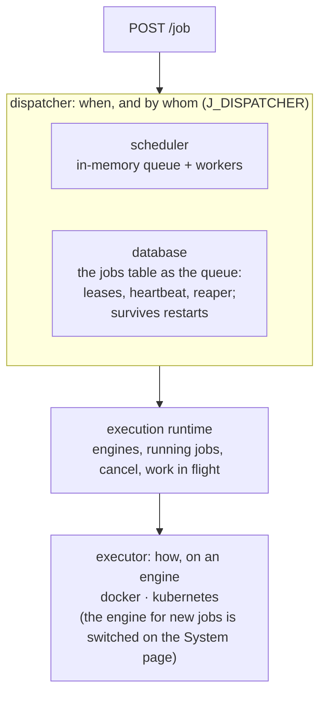

# Kuspace

## A system platform that provides modular batch processing applications for users to run on an end system

### Development Instructions

[DEV]
First-time setup (minioth submodule, fresh secrets, compose env):

    make setup

Run the whole stack locally with docker-compose and check it end to end:

    make up
    make smoke

The web interface is then at <http://localhost:18080>.
Everything else is listed by

    make

use scripts/kuspacectl.go to deploy/destroy/build on kubernetes (or `make k8s-*`)

    go run scripts/kuspacectl.go -h

### Description

Users log in through a web interface, upload data, and run "jobs" on it:
either one of the builtin applications (duckdb, pandas, octave, ffmpeg, bash, ...)
or their own code. Jobs execute on kubernetes (or docker), and their output
streams back live.

### Architecture

A job goes through three layers in uspace
([details](internal/uspace/README.md#jobs)):

### Microservices

- identity provision (minioth)  
- central API for storage and for submitting "jobs" ([uspace](internal/uspace/README.md))  
  - user defined orchestration  
  - code as jobs execution  
  - builtin applications (modular)  
- websocket streaming for logs/results/output ([wss](internal/wss/README.md))  
- frontend application for i/o + management (frontapp)  

### More

- storage provider (configurable)
  - minio  
            (bundled in docker-compose; its root password comes from the secrets file)  
    or
  - [fslite](pkg/fslite/README.md) [custom implementation]
            (a pretty basic fs storing mechanism, with an api and a database holding file metadata)

- minioth (identity provider) [custom implementation, own repository]

    developed at <https://github.com/kyri56xcaesar/minioth>, pinned here as the
    git submodule `third_party/minioth` (currently v1.1.2)

    admin account: `kuspaceadmin`, password = `MINIOTH_SECRET_KEY` from `configs/secrets.env`

    storage as

             - 1. database as storage (sqlite3)
             - 2. plain text as storage (passwd,group,shadow)

- job scheduling mechanism (modular/configurable, `J_DISPATCHER`)
      - simple in-memory queue (default)
      - the jobs table as the queue: jobs survive uspace restarts

- job execution system (modular/configurable)
      - kubernetes
      - docker
      - both available at once; admins switch the engine for new jobs at runtime

- (central) uspace API for accessing + using everything

- frontend application (dashboard, job browser, file management, admin panel)

- random data generation and secret generation tools

### Configuration & secrets

- `configs/*.conf` hold the non-secret settings of each service
- every secret (JWT keys, service secret, passwords) lives only in
  `configs/secrets.env`, which is gitignored; `make secrets` creates it with
  random values from `configs/secrets.env.example`
- docker-compose reads it through `deployments/docker-compose/.env`, and
  kuspacectl turns it into the kubernetes Secrets

### Documentation

Both generators run at pinned versions through `go run` (nothing to install):

- `make api-docs` regenerates the Swagger docs in `api/` from the handlers'
  annotations (swag); tests fail when an annotation and the routes disagree.
- `make code-docs` builds browsable code docs for fslite and uspace in
  `docs/code` (golds; open `docs/code/index.html`, ~310 MB, gitignored).
  `make code-docs CODE_DOCS_SOURCE=external` links the source on GitHub
  instead (~90 MB; the current commit must be pushed).

changes, known issues and planned work are tracked in [BACKLOG.md](BACKLOG.md)

### Goals

>
> - ease of access to an end system (kubernetes)
>
> - user environment
>
